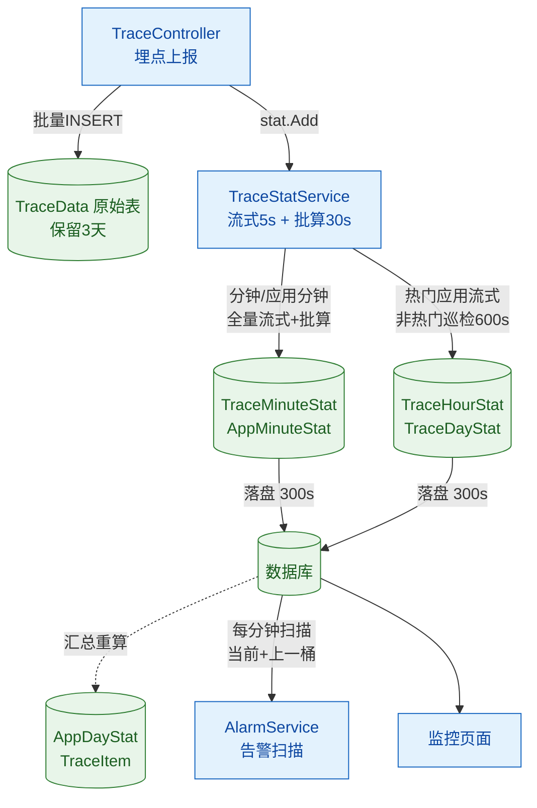
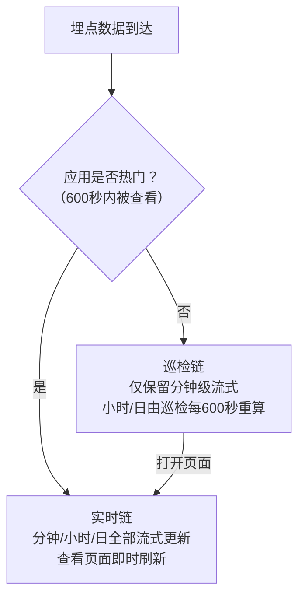
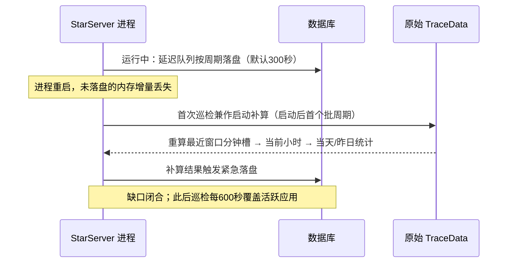

# APM 监控中心 - 星尘监控系统架构

> **版本**：v2.1 | **更新时间**：2026-09-11 | **文档状态**：最新稳定版
> 对应模块：APM 监控中心 / APM
> 相关文档：[APM-3-链路追踪统计](APM-3-链路追踪统计.md) | [APM-17-监控接入API](APM-17-监控接入API.md)

---

## 1. 概述

星尘（Stardust）是一个轻量级分布式监控平台，为企业提供应用性能监控（APM）能力。系统采用**客户端采样统计 + 服务端多级汇总**的架构，在保证监控精度的同时，大幅降低了网络传输和存储成本。

### 1.1 核心设计理念

与传统 APM 系统（如 SkyWalking、Jaeger）全量采集不同，星尘采用：

| 特性 | 传统 APM | 星尘 |
|------|---------|------|
| 数据采集 | 全量采集，服务端聚合 | 客户端采样+统计，服务端汇总 |
| 网络开销 | 高（每次调用上报） | 低（周期性批量上报统计） |
| 存储压力 | 极高 | 可控 |
| 实时性 | 高 | 分钟级 |

### 1.2 系统定位

- **目标用户**：企业内部部署
- **典型规模**：
  - 应用数量：20~100 个
  - 埋点总数（TraceItem）：几十万个（建议控制在 10 万以内）
  - 单应用埋点数：100~300 个（不建议超过 1000 个）
  - 每日跟踪数据（TraceData）：2000~5000 万行
  - 每日埋点统计调用：10 亿+ 次

---

## 2. 系统架构

### 2.1 整体架构图

```
┌─────────────────────────────────────────────────────────────────────────────┐
│                              应用层（客户端）                                 │
├─────────────────────────────────────────────────────────────────────────────┤
│  ┌─────────────┐  ┌─────────────┐  ┌─────────────┐  ┌─────────────┐        │
│  │   App A     │  │   App B     │  │   App C     │  │   App ...   │        │
│  └──────┬──────┘  └──────┬──────┘  └──────┬──────┘  └──────┬──────┘        │
│         │                │                │                │               │
│         │     ┌──────────┴────────────────┴────────────────┘               │
│         │     │   StarTracer（每实例一个）                                  │
│         │     │   - 自动埋点：DB/Redis/HTTP/WebAPI                         │
│         │     │   - 周期采样（默认60秒）                                    │
│         │     │   - 本地统计：次数/耗时/错误                                │
│         └─────┴──→ ProcessSpans() 上报                                     │
└───────────────────────────────────┬─────────────────────────────────────────┘
                                    │ HTTP POST (JSON/GZip)
                                    │ 每应用每分钟上报一次
                                    ▼
┌─────────────────────────────────────────────────────────────────────────────┐
│                            服务端（Stardust.Server）                         │
├─────────────────────────────────────────────────────────────────────────────┤
│  ┌─────────────────────────────────────────────────────────────────────┐   │
│  │                        TraceController                               │   │
│  │  Report() / ReportRaw() → ProcessData()                               │   │
│  │  1.过滤异常埋点 2.GetOrAddItem 3.生成TraceData 4.生成SampleData 5.批量插入│  │
│  └──────────────────────────────────────────────────────────────────────┘   │
│                                              │                              │
│                    ┌─────────────────────────┼─────────────────────────┐    │
│                    ▼                         ▼                         ▼    │
│  ┌─────────────────────────┐  ┌─────────────────────────┐  ┌────────────┐  │
│  │   TraceStatService      │  │   AppDayStatService     │  │ ItemStat   │  │
│  │   追踪统计服务           │  │   应用天统计服务         │  │ 埋点统计   │  │
│  │   (80%资源占用)         │  │                         │  │            │  │
│  └─────────────────────────┘  └─────────────────────────┘  └────────────┘  │
└─────────────────────────────────────────────────────────────────────────────┘
```

### 2.2 数据流向

```
客户端采样周期（60秒） → SpanBuilder[] → TraceController.Report()
    → ProcessData → TraceData/SampleData（批量INSERT）
    → 统计队列 → TraceStatService（流式+批量）
    → TraceMinuteStat → TraceHourStat → TraceDayStat → AppDayStat
```

> 注：2026-09 起统计计算分为**告警链 / 汇总链**两层：分钟级为告警链（全量）；小时/日级为汇总链（热门应用实时、非热门由巡检按周期重算）。详见 §4.3。

---

## 3. 客户端架构

### 3.1 StarTracer 核心组件

`StarTracer` 是星尘监控客户端的核心实现，继承自 `DefaultTracer`，位于 `Stardust\Monitors\StarTracer.cs`。

#### 核心职责

| 职责 | 说明 |
|------|------|
| 自动埋点 | 通过 DI 注入后，自动为 DB/Redis/HTTP/WebAPI 等建立埋点 |
| 本地统计 | 在采样周期内收集调用次数、耗时、错误等统计信息 |
| 数据上报 | 通过 `ProcessSpans()` 将统计数据上传到星尘服务端 |
| 参数同步 | 接收服务端下发的采样参数（周期、采样数等） |

#### 关键配置参数

| 参数 | 默认值 | 说明 |
|------|--------|------|
| `Period` | 60秒 | 采样周期，每周期上报一次 |
| `MaxSamples` | 1 | 每周期正常采样数 |
| `MaxErrors` | 10 | 每周期异常采样数 |
| `MaxFails` | 2880 | 最大失败队列长度（约2天） |
| `TrimSelf` | true | 剔除埋点上报自身的调用 |
| `EnableMeter` | true | 是否收集应用性能信息 |

### 3.2 上报数据结构

每个 `SpanBuilder` 包含该埋点在本周期内的统计信息：

```json
{
  "Name": "/api/user/info",
  "Total": 1000,        // 本周期总次数
  "Errors": 5,          // 错误次数
  "TotalCost": 15000,   // 总耗时(ms)
  "MaxCost": 200,
  "MinCost": 5,
  "Samples": [...]      // 正常采样
}
```

**关键理解**：客户端在本地已完成统计汇总，一个埋点在一个周期内无论调用1000次还是10000次，都只上报一条 SpanBuilder。

### 3.3 埋点名称与自动截断

WebApi 请求的埋点名称由 `TracerMiddleware`（`Stardust.Extensions\TracerMiddleware.cs`）生成。名称是客户端本地聚合的键：**同名埋点在采样周期内只上报一条 SpanBuilder**，因此命名必须在客户端完成参数归并。否则"参数进路径"的系统会产生大量唯一点名，上报体积随参数基数膨胀。

自动截断规则（默认启用，可通过 `TracerMiddleware.EnableAutoName` 关闭并回退到传统规则——WebApi保留两段、魔方保留三段）：

| 规则 | 说明 |
|------|------|
| 完整URL为基准 | 路径各段稳定时使用完整URL作名称，如 `/v1/chat/completions`（查询串不参与命名） |
| 统计学习 | 某前缀下"不同子值"数量达到16个（`TracerMiddleware.MinDistinct` 可调），即判定其后为可变参数区；数字ID、GUID、随机字符串等一切可变值统一由此识别 |
| 放行路径 | 魔方区域（`AreaNames` 首段命中）与自定义规则（`TracerMiddleware.AllowPaths`，`IList`、支持*模糊匹配、可运行时追加）命中的路径保留完整URL，且不参与学习统计 |
| 学习持久化 | 判定结果自动写入 `Config\Star.config` 的 `TraceNamePrefixes`（分号隔开），跨进程复用，支持手工调整与热更新 |
| 名称上限 | 200字符，与跟踪数据 Name 字段保持一致 |

学习只使用本地观察到的原始路径，不增加上报数据量。冷启动时每个参数前缀最多产生16个瞬态名称（之后归并；已持久化配置的前缀不产生瞬态名称）。典型效果：

| 请求 | 埋点名称 |
|------|----------|
| `/v1/chat/completions` 调用1000次（查询串不同） | `/v1/chat/completions`，单条 SpanBuilder 上报 |
| `/api/order/{id}`（1000个不同ID） | `/api/order` |
| `/Admin/User/Edit` | `/Admin/User/Edit` |

**下游定制**：最终名称经 `ITracer.Resolver.ResolveName(name, HttpContext)` 产出，应用可继承 `StarTracerResolver` 重写该方法自定义 WebApi 埋点名称，返回空时跳过该埋点。

---

## 4. 服务端架构

### 4.1 TraceController 数据接收

位于 `Stardust.Server\Controllers\TraceController.cs`。

#### 接口定义

| 接口 | 方法 | 说明 |
|------|------|------|
| `/Trace/Report` | POST | 接收普通埋点数据（JSON） |
| `/Trace/ReportRaw` | POST | 接收压缩后的大数据量（GZip） |

#### ProcessData 核心处理流程

```
1. 数据过滤：跟踪规则黑名单 / 应用排除项 / 时间范围 / 名称长度
2. 获取跟踪项：GetOrAddItem（已知性能瓶颈点，已有10分钟缓存）
3. 生成入库数据：TraceData + SampleData
4. 批量入库：支持自动分表
5. 加入统计队列：触发 TraceStatService / AppDayStatService / ItemStatService
```

### 4.2 TraceStatService 统计服务

位于 `Stardust.Server\Services\TraceStatService.cs`，是星尘服务端的**核心性能瓶颈**，占用约80%的服务器资源。

#### 双模式统计策略

| 模式 | 周期 | 方法 | 说明 |
|------|------|------|------|
| 流式计算 | **5秒** | `DoFlowStat()` | 增量累加：分钟/应用分钟全量；小时/日级统计仅热门应用 |
| 批量计算 | **30秒** | `DoBatchStat()` | 覆盖重算：按登记包修正分钟统计；小时/日登记包仅热门应用 |

> 周期均可通过 `MonitorFlowPeriod` / `MonitorBatchPeriod` 配置热更新。

#### 多级统计汇总

```
TraceData → TraceMinuteStat（5分钟粒度）→ TraceHourStat → TraceDayStat → AppDayStat
```

#### 延迟队列机制

使用 `EntityDeferredQueue` 实现批量数据库更新，四个队列共享一个落盘周期，查看页面会触发即时落盘：

| 队列 | 落盘周期 | 说明 |
|------|---------|------|
| MinuteQueue | `MonitorSavePeriod`（默认300秒） | 分钟统计，告警数据源（告警读取内存实时值，不受落盘周期影响） |
| AppMinuteQueue | `MonitorSavePeriod`（默认300秒） | 应用分钟统计 |
| HourQueue | `MonitorSavePeriod`（默认300秒） | 小时统计 |
| DayQueue | `MonitorSavePeriod`（默认300秒） | 天统计 |

---

### 4.3 统计计算机制与降载设计

> 2026-09 引入“分层降载”：把统计链路分为**告警链**与**汇总链**，用“内存实时值 + 稀疏落盘 + 巡检重算”替代高频全量重算，目标是降低监控统计自身对数据库的写压力。

#### 总体数据流



#### 热门应用与巡检分层



- **热门窗口**：查看监控页面时，`HotAppService` 通过事件总线 `Star-HotApp` 通知服务端 `SetHotApp`，窗口（600秒）内保持流式实时，并立即登记重算（分钟槽+当前小时+当天）、触发队列落盘；
- **巡检**：非热门应用不登记小时/日重算包，由巡检按 `MonitorPatrolPeriod`（默认600秒）对活跃窗口（巡检周期×3，默认30分钟）内的应用重算当前小时与当天统计；小时切换后延迟一轮从分钟统计收尾上一小时（覆盖巡检间隙数据）；跨天后由首个巡检补算昨日最终值；
- **幂等重算**：所有聚合均为“从下层全量覆盖”：分钟←原始数据、小时←分钟、日←小时、应用日←日统计，任意时刻可重建。

### 4.4 重启与数据一致性

统计数据在落盘前驻留内存，进程重启会丢失未落盘的聚合增量。系统通过“原始数据 + 幂等重算 + 三件套防护”保证不丢数：



| 内存状态 | 丢失后果 | 恢复路径 |
|---------|---------|---------|
| `_queue` 未消费原始数据 | 分钟增量少计 | 启动补算/巡检按原始数据重算 |
| 延迟队列缓冲（≤落盘周期） | 分钟/小时/日少计 | 同上（分钟由原始数据重建） |
| 活跃登记与热窗口 | 巡检/实时性下降 | 随新数据与页面访问自动重建 |

优雅停机时通过 `IHostApplicationLifetime.ApplicationStopping` 触发 `Flush()`，把四个延迟队列的缓冲同步落盘，进一步缩小重启缺口。

### 4.5 告警链路与延迟预算

告警服务 `AlarmService` 每 `AlarmPeriod`（默认30秒）扫描一次：应用告警读 `AppMinuteStat`、埋点告警读 `TraceMinuteStat`。

- **内存实时值优先**：告警通过 `ITraceStatService.GetLiveMinute/GetLiveAppMinute` 直接读取延迟队列中的内存实体，未命中时回落数据库。落盘周期（默认300秒）不再约束告警时效；
- **错误率现场计算**：`ErrorRate` 列在保存校验时计算，内存实体需按`错误数/总次数`现场计算；
- **回溯桶**：固定检查当前与上一个5分钟桶，兜底进程重启或数据晚到落库的场景；
- **紧急落盘**：告警触发后调用 `TriggerFlush()` 立即提交分钟级队列，保证告警依据及时入库。

延迟预算（默认配置）：

| 环节 | 耗时 |
|------|------|
| 上报 → 流式增量入内存 | ≤5秒（FlowPeriod） |
| 告警扫描周期 | ≤30秒（AlarmPeriod） |
| **端到端（内存判定）** | **≈35秒** |
| 数据库落盘（不影响告警） | ≤300秒（MonitorSavePeriod） |

---

## 5. 数据存储

### 5.1 核心数据表

| 表名 | 说明 | 分表策略 | 每日数据量 |
|------|------|----------|-----------|
| `TraceData` | 跟踪数据（原始） | 31张表（按天） | 2000~5000万行 |
| `SampleData` | 采样数据（明细） | 31张表（按天） | 几千万行 |
| `TraceMinuteStat` | 分钟统计 | 无 | < 200万行 |
| `TraceHourStat` | 小时统计 | 无 | < 20万行 |
| `TraceDayStat` | 天统计 | 无 | < 10万行 |
| `AppMinuteStat` | 应用分钟统计 | 无 | < 3万行 |
| `AppDayStat` | 应用天统计 | 无 | < 100行 |
| `TraceItem` | 跟踪项（埋点定义） | 无 | < 10万行 |
| `AppTracer` | 应用跟踪器配置 | 无 | < 1000行 |

### 5.2 分表策略

`TraceData` 和 `SampleData` 采用按天分表（31张循环）。

### 5.3 数据保留策略

| 保留天数 | 适用场景 |
|---------|---------|
| 3~7天 | 数据库压力大 |
| 7~15天 | 标准配置 |
| 15~30天 | 高配环境 |

### 5.4 数据库优化

- **MySQL 压缩表**：`ROW_FORMAT=COMPRESSED`
- **XCode 累加字段**：`UPDATE SET Total=Total+@Total`
- **延迟队列**：批量提交减少IO

---

## 6. 性能分析与优化

### 6.1 性能瓶颈点

| 瓶颈点 | 严重程度 | 说明 |
|--------|---------|------|
| 延迟队列 UPDATE | **严重** | 4个延迟队列批量提交，数据库CPU和IO高 |
| 流式计算频率 | 中等 | 每5秒执行一次，过于频繁 |
| GetOrAddItem | 中等 | 埋点查找/创建涉及数据库 |

### 6.2 已实施的优化

1. **参数调优**：默认配置 5秒/30秒（流式/批算），支持运行时热更新
2. **流式计算精简**：小时/日统计仅热门应用流式更新，其余交给巡检重算（小时切换后收尾上一小时）
3. **分层落盘**：分钟级 300 秒、汇总级 120 秒；告警读取内存实时值，不再等待落盘
4. **巡检替代事件重算**：非热门应用的小时/日统计由 600 秒巡检重算（原先每个批周期全量重算，造成写放大）
5. **内存告警 + 紧急落盘**：告警触发后立即提交分钟级队列，回溯桶兜底晚到数据
6. **重启防护**：启动补算 + 巡检自愈 + 优雅停机 Flush，重启不丢统计

### 6.3 配置参数

| 参数 | 默认值 | 说明 |
|------|--------|------|
| MonitorFlowPeriod | 5秒 | 流式计算周期 |
| MonitorBatchPeriod | 30秒 | 批量计算周期（分钟级纠偏） |
| MonitorSavePeriod | 300秒 | 落盘周期（告警读内存实时值、查看页面即触发落盘） |
| MonitorPatrolPeriod | 600秒 | 非热门应用巡检重算周期（活跃窗口=周期×3） |
| AlarmPeriod | 30秒 | 告警扫描周期 |

全部参数存储在数据库 `StarServer` 配置分类（`StarServerSetting`），修改后热更新生效（统计服务参数通过 `Provider.Changed` 回写，部分参数下一周期生效）。

> 其余细节为代码内常量：热门窗口600秒、内存队列上限10万条、跟踪项统计1800秒；告警固定检查“当前桶+上一桶”。

---

## 7. 附录

### 7.1 关键代码位置

| 功能 | 文件路径 |
|------|---------|
| 客户端核心 | `Stardust\Monitors\StarTracer.cs` |
| 服务端接收 | `Stardust.Server\Controllers\TraceController.cs` |
| 追踪统计服务 | `Stardust.Server\Services\TraceStatService.cs` |
| 应用天统计服务 | `Stardust.Server\Services\AppDayStatService.cs` |
| 应用跟踪器 | `Stardust.Data\Monitors\应用跟踪器.Biz.cs` |

### 7.2 后续计划

| 项目 | 优先级 | 说明 |
|------|--------|------|
| 按需计算 | 已完成 | 查看页面自动标记热门，即时登记重算并加速落盘（§4.3） |
| GetOrAddItem优化 | 中 | 延长缓存、批量预热 |
| 智能调度 | 中 | 根据负载动态调整频率 |
| 时序数据库支持 | 低 | 考虑 InfluxDB/TimescaleDB |
