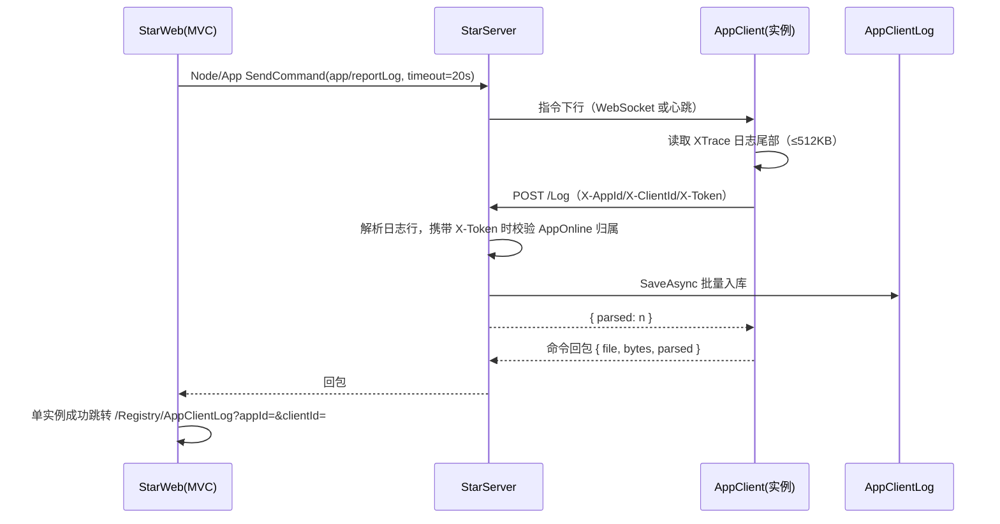

# LOG-4 应用实例日志上报

> 版本：v1.0 | 日期：2026-11-23
> 关联：`Doc/需求文档.md` §3.9、`Doc/DEPLOY-1-节点应用日志.md`（部署节点文件日志，另一条链路）
> 状态：**MVC MVP 已实现**（2026-11-23）

---

## 1. 背景

运维在应用在线表发现某个实例异常时，过去只能登录机器或让应用持续上报日志。星尘 SDK 并没有真正的日志上报客户端（功能清单 SDK-7 为过期条目），`AppClientLog` 只能依赖应用自行配置 `NetworkLog`。因此补一条按需链路：**选中实例 → 要求它上报本地当日日志 → 平台入库 → 在应用日志页查看**。

与已有能力的区别：

| 能力 | 说明 |
|------|------|
| **LOG-4 实例日志上报** | 按实例主动拉取应用自身日志，适合临时排查 |
| AppClientLog 持续上报 | 应用自行配置 `NetworkLog`，平台被动接收 |
| DEPLOY-1 部署节点文件日志 | 读部署节点磁盘目录，不要求应用集成 SDK |

## 2. 目标

1. AppClient 新增 `app/reportLog` 指令，读取自身日志目录下的当日文件尾部并上报。
2. StarServer `/Log` 返回已识别日志行数，供页面提示。
3. MVC 应用在线表新增「上报日志」批量按钮；单实例成功后跳转应用日志页按 appId + clientId 过滤。
4. 应用日志页补实例与级别过滤。
5. Vue 入口后续按同一契约补做。

## 3. 指令契约

### `app/reportLog`

注册于 `AppClient.Attach`，请求参数 JSON（可空）：

```json
{ "maxBytes": 262144 }
```

- `maxBytes`：最大读取字节数，默认 256KB，上限 512KB。
- 日志目录：`AppClient.LogPath`（显式配置）优先，否则 `XTrace.Log` 中的 `TextFileLog.LogPath`，最后 `XTrace.LogPath`。
- 文件：`yyyy_MM_dd.log`；当日文件不存在时退化为目录内最新 `*.log`。
- 读取：`FileShare.ReadWrite`，允许日志正在写入时读取。

回包 `CommandReplyModel`：

| 字段 | 说明 |
|------|------|
| Status | 成功 `已完成`，失败 `错误` |
| Data | 成功时为 `AppLogReportResult` JSON：`{ file, bytes, parsed }`；失败时为错误文本 |

错误场景：

- 未找到日志文件：`Log file not found: {0}`
- 服务端地址非 http/https：`Server address does not support HTTP log upload.`
- 上传失败：`Log upload failed: {0}`

## 4. 上报流程



## 5. MVC 交互

- 应用在线表工具栏「上报日志」：`data-action="action"` 提交选中行。
- 单实例成功：`Json` 返回 `{ url, time: 1 }`，Cube 前端提示后跳转日志页。
- 多实例：`JsonRefresh` 汇总成功/失败/离线跳过，并列出错误详情。
- 行内「日志」链接：直接打开该实例当天的日志页（不触发上报）。
- 旧版 SDK 回包 `Cannot find service [app/reportLog]` 时提示升级星尘客户端。
- 权限：`PermissionFlags.Update`（日志可能含敏感信息，不开放给只读账号）。

## 6. 安全与限制

- 平台不能指定日志路径，实例只读自身日志目录。
- 单次读取上限 512KB；重复点击会产生重复日志记录。
- `/Log` 携带 `X-Token` 时校验令牌属于该应用的在线实例；旧客户端不带令牌保持原行为。
- 只支持当天日志文件，跨天排查暂不支持。
- 应用未写本地日志文件时明确报错，不静默成功。
- 日志内容不做脱敏，与现有应用日志页一致。

## 7. 代码位置

| 层 | 路径 |
|----|------|
| SDK 指令 | `Stardust/Managers/AppLogCommands.cs`、`Stardust/AppClient.cs`（`DoReportLog`/`LogPath`） |
| 服务端接收 | `Stardust.Server/Controllers/LogController.cs` |
| MVC | `Stardust.Web/Areas/Registry/Controllers/AppOnlineController.cs`、`AppClientLogController.cs`、`Areas/Registry/Views/AppOnline/_List_Toolbar_Batch.cshtml`、`Areas/Registry/Views/AppClientLog/_List_Search.cshtml` |
| 多语言 | `Stardust/Locales/*.yml`、`Stardust.Web/Locales/*.yml` |

## 8. 测试

| 层级 | 文件 | 覆盖 |
|------|------|------|
| SDK 单元 | `ClientTest/AppLogCommandsTests.cs` | 当日文件/最新文件/单文件/缺目录、尾部截取、空文件、请求头与正文、parsed 解析（9 例） |
| 服务端接收 | `Stardust.ServerTests/Controllers/LogPostTests.cs` | 日志行解析落库、返回 parsed、未启用应用忽略、跨应用令牌 403（3 例） |
| 端到端 | `Stardust.ServerTests/Communication/AppCommunicationTests.cs` | 真实 AppClient → 真实 StarServer → 指令 → 上传 → `AppClientLog` 落库 |
| MVC 逻辑 | `Stardust.ServerTests/Web/AppOnlineControllerTests.cs` | 旧 SDK 升级提示、批量摘要 |
| 词表 | `check-locales.ps1` | `Stardust`（存在历史孤儿键）与 `Stardust.Web` 通过 |

## 9. 兼容与后续

- 旧 SDK：无 `app/reportLog` 指令，页面提示升级。
- 应用使用非 XTrace 日志格式：`/Log` 解析 0 行，页面提示检查格式。
- 后续：
  - Vue 应用在线/实例页补「上报日志」入口与 WebApi 动作。
  - 可选：历史日期日志（需按文件日期写分表）。
  - 可选：内存环形缓冲，覆盖未写文件日志的应用。
