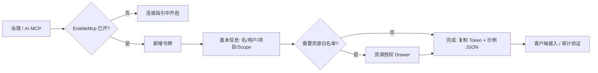

# MCP 控制台用户旅程与交互评估

> 版本：**v1.2** | 日期：2026-11-02  
> 范围：`StardustLayout2` → 治理 `/mesh` → **AI / MCP** 页（`McpTab.vue` 及子组件）  
> 相关：`Doc/MCP-1-token管理.md`、`Doc/MCP-4-平台MCP重新设计.md`、走查截图 `Stardust.Web.Vue/.temp/mcp-journey-walk/*.png`  
> **日常怎么点**：见下文 **[§12 控制台操作说明（现行）](#12-控制台操作说明现行)**（管理员/运营按步骤操作即可；§4～§7 含改造前走查与评估，供对照）。

---

## 1. 为什么要写这份文档

管理员反馈：**当前 MCP 管理交互偏复杂、不够直观**，尤其是「资源授权」依赖 **点击令牌行 → 页面下方出现面板**，与「通过明确操作进入授权」的预期不一致。

本文档先梳理 **主要用户旅程** 与 **权限在界面上的三层含义**，再记录 **2026-11-02 浏览器走查**（5188 + 远端 6681，admin 登录）下的主观可用性评价，并给出 **是否需改善** 与 **改进方向**（供产品/前端迭代，不要求与本迭代同步改代码）。

---

## 2. 角色与典型目标

| 角色 | 目标 |
|------|------|
| **平台管理员** | 打开 MCP 服务、发 Token、回收/轮换、看审计 |
| **项目 Owner（如 IOC）** | 给某成员（如 70298304）发 **仅本项目** 的 Agent 凭证 |
| **接入方（Cursor/脚本）** | 拿到 URL + Bearer，能 `tools/list` 并调用 |
| **排障者** | 连不上、403、工具缺失时快速定位 EnableMcp / Scope / 成员关系 |

---

## 3. 页面上到底有几层「授权」（心智模型）

后端有效权限可理解为（表单副标题已写一句，但页面其他区域未反复强调）：

```text
实际能力 ≈ EnableMcp 总开关
         × 令牌启用 & 未过期
         × 绑定用户 ∈ 绑定项目（ProjectUser）
         × 令牌 Scope（域:读/写/高危）
         × 资源授权行（可选，进一步收窄 Project/Node/App）
         × 平台 McpActionSet / 敏感词等（连接指引只读展示）
```

**界面却把五块竖条堆在同一 Tab 里**，且 **Scope（表单矩阵）** 与 **资源授权（下方表格）** 名称相近、位置分离，是「看不懂」的主要来源。

---

## 4. 信息架构（AI / MCP Tab 自上而下，v1.1 起）

| 顺序 | 区域 | 用户心智 | 主要操作 |
|------|------|----------|----------|
| 0 | **连接指引** | 「服务开没开、URL 是什么」 | 复制端点/示例 JSON；开关 EnableMcp（GuardModal） |
| 1 | **MCP 服务器** | 「注册**外部** MCP 端点」（与平台 `/mcp` 不同） | **默认折叠**；展开后新增/编辑/启停/删除 |
| 2 | **MCP 令牌** | 「发 **sdmcp_** 凭证」 | 新增/编辑/启停/**资源授权**/重置/删除；项目 **过滤**（客户端） |
| 3 | **资源白名单** | 「在 Scope 之上再收窄实体」 | **行内「资源授权」→ 右侧 Drawer**（不在页底） |
| 4 | **调用审计** | 「谁调了什么」 | 近期 / 查询历史 + 分页 |

**进入路径**：顶栏 **治理** → 默认 **AI / MCP** Tab（`localStorage` 记忆上次 Tab；URL 可用 `/mesh?tab=mcp`）。

---

## 5. 主要用户旅程

### J1 · 第一次让 Agent 连上星尘 MCP（最高频）

| 步骤 | 用户动作 | 系统反馈 | 痛点 |
|------|----------|----------|------|
| 1 | 顶栏 → **治理** → **AI / MCP** | 默认在「注册中心」，需多点一次 Tab | 入口深；首屏不是 MCP |
| 2 | 看 **连接指引** EnableMcp | Tag 显示开/关 | 与令牌区距离远，易忘记检查 |
| 3 | 复制 **MCP 端点** + 示例 JSON | Toast 复制成功 | 示例里 Bearer 占位，需自己替换 |
| 4 | **新增令牌** → 填名称/用户/项目/Scope → 创建 | 一次性 Token 弹窗 | Scope 不勾时后端默认 7 域只读，**表单与结果不一致** |
| 5 | 复制完整 Token → 写入 Cursor MCP 配置 | 关闭后仅掩码 | 合理（安全） |
| 6 | 客户端 `tools/list` / 调工具 | 审计区可见记录 | 失败原因分散在 EnableMcp/成员/Scope |

**旅程结论**：能走通，但 **步骤 1、4、6 的认知负担大**；缺少「向导式：开服务 → 建 Token → 复制配置」一条线。

---

### J2 · 给项目成员发一枚 Token（如 IOC + 70298304）

| 步骤 | 用户动作 | 说明 |
|------|----------|------|
| 1 | 新增令牌 Drawer | 绑定用户、绑定项目必选才有业务意义 |
| 2 | 选用户 **70298304**、项目 **IOC** | 下拉仅显示账号名，尚可 |
| 3 | Scope | 只读巡检可不勾（依赖后端默认）；要写操作需自行勾写/高危 |
| 4 | 创建 | 列表「绑定」列仍显示 **用户 #2** 而非账号名，**核对不便** |

**旅程结论**：创建路径清晰（Drawer + 主按钮）；**展示层**对运营不友好。

---

### J3 · 配置「资源白名单」（v1.1 已改交互）

**现行操作**（详见 §12.5）：在令牌表该行点击 **「资源授权」** → 右侧 Drawer **「资源白名单 · {令牌名}」** → 选类型（项目/节点/应用）与具体资源 → **添加授权**；行内可启停/删除。不添加任何行 = **不额外收窄**（仍受 Scope、绑定用户/项目等约束）。

**创建后快捷路径**：新建令牌时若 **绑定了项目**，保存并关闭创建 Drawer 后，列表刷新完毕会 **自动打开** 该令牌的资源白名单 Drawer，便于立刻收窄（可关 Drawer 跳过）。

**改造前问题（v1.0 走查，已废弃交互）**：点行 + 页底面板——见截图 `04-after-select-token-resource-panel.png` 与 §6 第 4 步。

---

### J4 · 编辑令牌 / 轮换 / 吊销

| 操作 | 入口 | 二次确认 | 评价 |
|------|------|----------|------|
| 编辑 | 行内 **编辑** → Drawer | 无 | 合理；Token 串不可改（正确） |
| 启停 | 行内 **停用/启用** | 无 | 可接受 |
| 重置 | 行内 **重置** | **GuardModal**（v1.1+） | 与删除同级二次确认 |
| 删除 | 行内 **删除** | GuardModal | 合理 |

---

### J5 · 排障「连不上 / 工具少 / 403」

用户需在 **同一长页** 内跳转：连接指引（EnableMcp）→ 令牌 Scope → 审计错误信息；**无聚合「诊断」视图**。

---

### J6 · 管理远端 MCP 服务器（低频）

**MCP 服务器** 与 **平台 Token** 并列，易误解为「发 Token 的前置步骤」。实际多数场景只需 **连接指引 + 令牌**。

---

## 6. 浏览器走查记录（2026-11-02）

环境：`http://127.0.0.1:5188`，后端 `http://10.188.32.212:6681`（与 `.env.development.local` 一致），admin 登录。

| # | 动作 | 观察 |
|---|------|------|
| 1 | 打开 `/mesh` | 默认 **注册中心** Tab，MCP 内容不可见 |
| 2 | 切换 **AI / MCP** | 首屏 **连接指引** + **MCP 服务器 0 个** + **令牌 3 枚**（需滚动） |
| 3 | 浏览令牌表 | 三枚 Token、Scope Tag 多；操作列 4 按钮，**无「资源授权」** |
| 4 | 点击第一行 | 需滚动才看到 **资源授权** 与选中 Token 名对应 |
| 5 | 点 **新增令牌** | 右侧 Drawer：Scope 7×3 矩阵，**默认全未勾选**；说明文字较小 |
| 6 | 滚至页底 | **审计** 区域再次拉长页面 |

截图目录：`Stardust.Web.Vue/.temp/mcp-journey-walk/`（`01`～`06`）。

---

## 7. 站在用户角度：是否简单？是否要改？

### 7.1 总体评分（主观，1～5，5=非常直观）

| 维度 | 分 | 说明 |
|------|----|------|
| 找到 MCP 管理 | 3 | 治理 + 子 Tab + 滚动 |
| 首次接 Agent（J1） | 3 | 指引好，但缺串联向导 |
| 新建令牌（J2） | 4 | Drawer 结构清楚 |
| **资源授权（J3）** | **2** | **点行 + 底部面板，不符合预期** |
| 日常运维（启停/删） | 4 | 行内操作明确 |
| 排障（J5） | 2 | 信息散 |

**结论**：**需要改善**；优先改 **资源授权的触达方式** 与 **权限三层说明**，其次做 **重置确认、默认 Scope 可见、用户展示名**。

### 7.2 与「简单直观」目标的差距（摘要）

1. **一个 Tab 承担太多故事**（外链 MCP 服务器 + 平台 Token + 审计 + 平台开关）。  
2. **选中行驱动下面板** = 隐式交互；用户要的是 **显式「资源授权」操作**。  
3. **Scope（能力域）** 与 **Resource（实体白名单）** 未分步、未命名区分。  
4. **创建时 Scope 空白 → 保存后满 Tag**，违背「所见即所得」。

---

## 8. 改进建议（按优先级）

### P0（建议尽快做，以交互为主、可少动后端）

| 建议 | 说明 |
|------|------|
| **令牌行增加「资源授权」按钮** | 打开 Drawer/Modal，内嵌现有 `McpTokenResourcePanel`；关闭后不必依赖行选中 |
| **弱化或移除「点行选中」作为主路径** | 选中仅用于高亮/审计筛选可选；授权以按钮为准 |
| **创建令牌 Wizard 第二步（可选）** | 「配置资源收窄（可跳过）」——与 J3 用户诉求一致 |
| **Scope 与资源文案拆分** | 表单用「工具域权限（Scope）」；面板用「资源白名单（可选）」+ 一句：不添加 = 不额外收窄 |

### P1

| 建议 | 说明 |
|------|------|
| 重置 Token **GuardModal** | 与删除同级 |
| 绑定用户展示 **账号名（#Id）** | 列表与 Drawer 一致 |
| 绑项目且 Scope 为空时，表单展示 **「将应用默认 7 域只读」** 预览 | 对齐后端 OnInsert |
| **MCP 子 Tab 默认 landing** 或治理页记住上次 Tab | 减少一次点击 |
| 折叠 **MCP 服务器** 或挪至「高级」 | 降低 J1 噪声 |

### P2

| 建议 | 说明 |
|------|------|
| Scope **预设模板**（只读巡检 / 发布 / 自定义） | 减少 7×3 矩阵焦虑 |
| 页内 **「接入检查清单」** 折叠条 | EnableMcp + Token + 试调用链接 |
| 审计与令牌行 **联动筛选**（点行过滤审计） | 排障更顺 |

---

## 9. 目标态用户旅程（建议产品方向）



v1.1 起产品行为已与上图一致（资源授权为行内按钮 / 创建后自动 Drawer，而非页底面板）。

---

## 10. 附录：走查截图索引

| 文件 | 内容 |
|------|------|
| `01-mesh-default-registry.png` | v1.0 走查：当时默认注册中心（v1.1 起默认 AI/MCP） |
| `02-mcp-tab-top.png` | MCP Tab 顶部：连接指引 + 服务器 + 令牌表头 |
| `03-mcp-token-table.png` | 令牌列表区域 |
| `04-after-select-token-resource-panel.png` | v1.0 走查：旧交互「点行 + 页底面板」（已废弃） |
| `05-create-token-drawer.png` | 新增令牌 Drawer（Scope 矩阵） |
| `06-mcp-audit-bottom.png` | 页底审计区 |

---

## 11. 修订记录

| 日期 | 版本 | 说明 |
|------|------|------|
| 2026-11-02 | v1.0 | 首版：旅程梳理 + 5188 走查 + 交互评估与 P0/P1/P2 建议 |
| 2026-11-02 | v1.1 | P0 已落地：资源授权 Drawer、重置 GuardModal、Scope 预览、用户展示名、服务器区折叠、治理 Tab 默认/记忆 MCP；后端 DefaultProjectReadScopes 常量 + Web 宿主默认 Scope 与 WebApi 对齐 |
| 2026-11-02 | v1.2 | 新增 **§12 控制台操作说明（现行）**；§4/J3/J4 与现行 UI 对齐；文首指向 §12 供日常操作 |
| 2026-11-02 | v1.3 | **§13 二次走查**（5188 + 远端 6681，Playwright 实点 + 截图 `mcp-journey-walk-v2/`） |

---

## 13. 二次走查评价（2026-11-02，v1.2 UI）

**环境**：前端 `http://127.0.0.1:5188`（admin / Admin@1234），API `http://10.188.32.212:6681`（`.env.development.local`）。自动化脚本：`.temp/mcp-journey-walk-v2.spec.ts`；截图目录：`Stardust.Web.Vue/.temp/mcp-journey-walk-v2/`（01～06）。页面 `pageerror` 为 0。

### 13.1 主观评分（1～5，5=非常直观）

| 维度 | 分 | 相对 v1.0 | 说明 |
|------|----|-----------|------|
| 找到 MCP | **4** | ↑ | 进 **治理** 即 **AI / MCP** Tab（`aria-selected=true`），少一次点击 |
| 首次接 Agent（J1） | **4** | ↑ | 连接指引端点/Bearer/`sk-mcp-` 示例 JSON 同屏；MCP 服务器默认折叠 |
| 新建令牌（J2） | **4** | ≈ | Drawer 清楚；绑项目后出现 **「将写入：7 域只读」** 预览，减轻「不勾 Scope 不知道会写啥」 |
| 资源白名单（J3） | **4** | ↑↑ | 行内 **「资源授权」→ 右侧 Drawer**，标题带令牌名，无需点行滚页底 |
| 重置 / 删除 | **3** | ↑ | **GuardModal** 文案清楚；**但远端 6681 未发布 Reset 路由修复时，点「确认执行」仍会失败**（见 13.3） |
| 排障（J5） | **3** | ≈ | 审计仍在长页底部；列表里可见个别工具/SQL 报错行，需展开才懂 |
| 整体「好不好用」 | **4** | ↑ | **P0 交互目标基本达成**；剩发布后端 + 信息密度与 Scope 矩阵焦虑 |

### 13.2 走查中验证通过的交互

1. **治理默认 MCP Tab**（01 截图）。
2. **连接指引**：EnableMcp 状态、复制端点、Bearer 占位已为 `sk-mcp-…`（02）。
3. **资源授权 Drawer**：点第一行「资源授权」→ 对话框「资源白名单 · {名}」+ 添加区（03）。
4. **新增令牌**：Scope 矩阵 + 绑项目后只读预览文案（04）。
5. **重置**：弹出 Production GuardModal，可取消（05）；未在本走查点「确认」以免改生产令牌。
6. **审计区**：可滚至底部查看（06）；GuardModal 打开时仍能看到下方审计表（页仍偏长）。

### 13.3 仍影响「好用」的阻塞/缺口

| 项 | 用户可见现象 | 状态 |
|----|--------------|------|
| **Reset API 未发布** | 走查日远端 `GET …/McpToken/Reset?id=` 仍 `code:500`（Detail 误匹配 `Reset`）；UI 层 Guard 已有，**确认后会 toast 失败** | 代码已修，需 **publish 6681** |
| **Token 新格式未发布** | 列表掩码仍为 `sdmcp_…` 且含特殊字符；指引已写 `sk-mcp-` | 代码已改 `GenerateToken`，需 **publish**；旧令牌 **重置** 后才变新格式 |
| **Scope 矩阵** | 7×3 勾选对新手仍重；预览仅覆盖「全不勾 + 已绑项目」 | P2 预设模板未做 |
| **一行六个按钮** | 停用/资源授权/编辑/重置/删除 挤在一起，小屏易误点 | 可收进「更多」或主次按钮 |
| **页内故事仍多** | 指引 + 令牌 + 审计纵向很长；服务器虽折叠但首屏仍偏「运维面板」 | 可接受，非 P0 |

### 13.4 结论（站在用户角度）

- **是否比改版前好用？——是。** 入口、资源授权路径、重置二次确认、Scope 预览、服务器折叠，都直接回应了 v1.0 吐槽。
- **现在能否顺畅「发 Key → 配白名单 → 给 Cursor」？——在发布后端后基本可以**；当前最大坑是 **远端未发布** 导致 **重置必挂**，以及 **新 Key 格式/Reset 修复** 未生效。
- **建议验收顺序**：① publish WebApi（含 Reset 路由 + `sk-mcp-` 生成）→ ② 浏览器走一遍「重置 → 复制新 Key → 资源授权 Drawer」→ ③ 再决定是否做 P2（Scope 模板、审计与令牌联动）。

---

## 12. 控制台操作说明（现行）

面向 **平台管理员 / 项目 Owner**：在星尘新控制台（`StardustLayout2`）里完成 MCP 开关、发 Token、资源白名单与排障。旧版 Razor 页（`/Platform/McpToken`）仍以 `Doc/MCP-1-token管理.md` 为准；**新控制台以本节为准**。

### 12.1 进入 MCP 管理

1. 登录控制台后，顶栏点 **治理**（路由 `/mesh`）。
2. 页内子 Tab 选 **AI / MCP**（首次进入治理时 **默认即此 Tab**；浏览器会记住上次 Tab，也可 bookmark `/mesh?tab=mcp`）。
3. 页面自上而下：**连接指引** → **MCP 服务器**（默认折叠）→ **MCP 令牌** → **调用审计**。

### 12.2 两层权限别搞混

| 名称 | 在哪配 | 含义 |
|------|--------|------|
| **工具域权限（Scope）** | 新增/编辑令牌 Drawer 内矩阵 | 能调用哪些 **工具域**（如 `apps:read`、`deploy:write`）；不勾选且 **已绑项目** 时，保存后服务端写入 **7 个只读域**（表单内有 **默认只读预览**） |
| **资源白名单（可选）** | 令牌行 **「资源授权」** Drawer | 在 Scope 之上，再限定可访问的 **项目 / 节点 / 应用** 实体；**一条都不加 = 不额外收窄** |

有效能力仍受：EnableMcp 总开关、令牌启用/过期、绑定用户 ∈ 绑定项目、平台 McpActionSet 等约束（连接指引区只读展示部分平台项）。

### 12.3 第一次让 Agent 连上（推荐顺序）

| 步 | 操作 | 说明 |
|----|------|------|
| 1 | **连接指引** 查看 EnableMcp | 若为关，点开关 → 确认 GuardModal → 等待成功提示 |
| 2 | 复制 **MCP 端点**（`…/mcp`）与 **示例 JSON** | Bearer 需换成下一步拿到的完整 Token |
| 3 | **MCP 令牌** 区点 **新增令牌** | 见 §12.4 |
| 4 | 在一次性弹窗 **复制完整 Token** | 关闭后列表仅显示掩码；丢失只能 **重置** |
| 5 | 把 Token 写入 Cursor / 脚本 MCP 配置 | 参考 `Doc/MCP-3-客户端接入.md` |
| 6 | 客户端调用后，在 **调用审计** 查看记录 | 失败时对照 EnableMcp、Scope、成员关系、错误信息 |

### 12.4 新建 / 编辑令牌

**新建**

1. 点 **新增令牌**（右侧 Drawer）。
2. 填写 **名称**；建议填写 **绑定用户**、**绑定项目**（Agent 以该用户身份、在该项目上下文中调用）。
3. **工具域权限（Scope）**：按需勾选读/写/高危；若已选项目且 **全部不勾**，注意表单下方 **「将应用默认 7 域只读」** 预览——保存后与后端一致。
4. 点 **创建** → 成功则：
   - 若返回了新 Token 字符串，**立即复制**（一次性展示）；
   - 若创建时 **绑定了项目**，列表刷新后会 **自动打开资源白名单 Drawer**（§12.5，可关）。
5. 列表 **绑定** 列显示 **账号名 (#用户Id)** 与项目名，便于核对（如 IOC + 70298304）。

**编辑**

- 行内 **编辑** → 可改名称、用户、项目、Scope、过期、备注等；**Token 串本身不可改**（需 **重置**）。

**列表过滤**

- 表头 **项目** 下拉：全部 / 未绑定 / 各项目——仅 **前端过滤** 当前已加载列表，不改变后端绑定关系。

### 12.5 配置资源白名单

1. 在目标令牌行，点 **资源授权**（与 编辑/重置 同一操作列）。
2. Drawer 标题：**资源白名单 · {令牌名}**。
3. 选择 **资源类型**（项目 / 节点 / 应用）→ **选择资源** → **添加授权**。
4. 已添加行可 **启用/停用** 或 **删除**；停用不等于删 Scope。
5. 配置完成点 Drawer 右上角关闭或遮罩关闭；**无需** 再向下滚动找页底面板。

### 12.6 令牌日常运维

| 意图 | 操作 |
|------|------|
| 临时禁用 | 行内 **停用**（立即拒绝 `-32001`） |
| 恢复 | 行内 **启用** |
| 泄露轮换 | **重置** → GuardModal 确认 → 复制 **新** Token（接口返回 `data.token` 一次性展示；旧串立即失效，资源白名单保留） |
| 彻底移除 | **删除** → GuardModal 确认 |

行内按钮在请求期间会 **loading + 禁用**，避免重复点击。

### 12.7 连接指引与平台只读项

- **EnableMcp**：本页开关 + GuardModal（写 StarServer 配置）。
- **McpActionSet / 敏感词** 等：只读展示，完整修改在 **治理 → 平台设置** 或后端配置（见 MCP-4）。
- **示例 JSON**：复制后把 `Bearer` 换成真实 Token。

### 12.8 调用审计

- **近期**：客户端过滤当前已拉取的最近记录。
- **查询历史**：填工具名、日期范围 → **查询** → 底部分页（服务端检索）。
- 展开行可看 Arguments、风险级别、Scope 快照、Before/After 等（排障 J5）。

### 12.9 MCP 服务器（低频 / 高级）

- 与 **平台 Token + `/mcp` 端点** 不同：用于登记 **其它 HTTP MCP 服务** 供平台引用。
- 区块 **默认折叠**；展开后 **新增服务器** → 填名称、远端地址、启用、归属项目等。
- 多数 Agent 接入 **只需 §12.3～12.5**，不必先配服务器。

### 12.10 给项目成员发 Token（示例：IOC + 70298304）

1. **新增令牌** → 绑定用户选 **70298304**（下拉为 `账号 (#Id)`）→ 绑定项目 **IOC**。
2. Scope：只读巡检可不勾（走默认 7 域只读）；发布/写操作再勾对应 **写/高危**。
3. 创建 → 复制 Token → 按需 **资源授权** 收窄到具体应用/节点。
4. 把端点 + Token 交给成员或写入其 IDE 配置。
