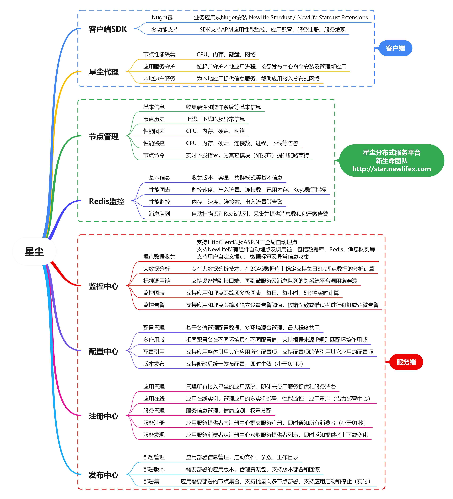
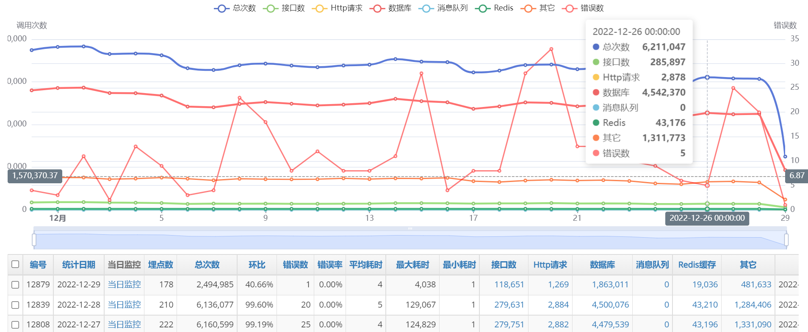
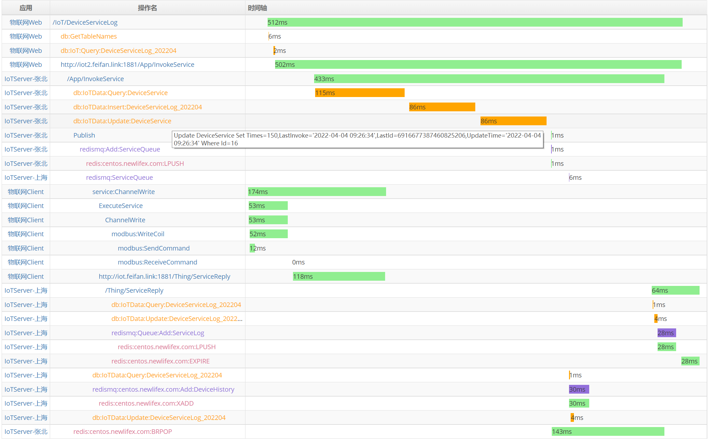
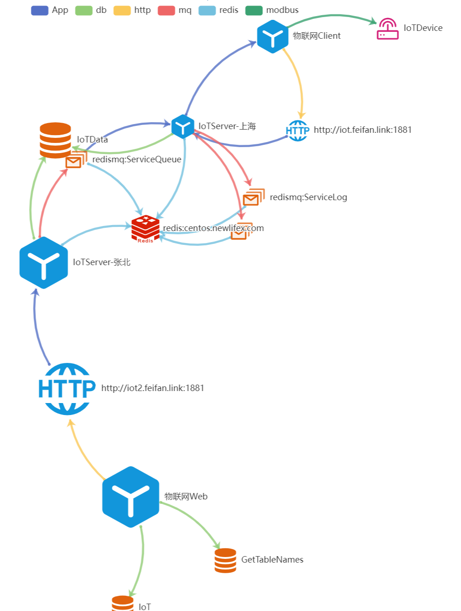

# NewLife.Stardust - 星塵分散式平台


[](https://github.com/NewLifeX/Stardust/actions/workflows/test.yml)
[](Doc/多语言本地化.md)


[](https://github.com/NewLifeX/Stardust/graphs/contributors)

<!-- lang:start -->
🌐 [English](README.md) | [简体中文](README.zh-CN.md) | [Español](README.es.md) | [Deutsch](README.de.md) | [日本語](README.ja.md) | [Français](README.fr.md) | [Português](README.pt.md) | [Русский](README.ru.md) | [한국어](README.ko.md) | [العربية](README.ar.md)
<!-- lang:end -->

> ⚠️ 本翻譯可能落後，以 [English README](README.md) 為準。

**星塵（Stardust）** 是輕量級分散式服務平台：節點管理、設定中心、註冊中心與服務探索、全鏈路追蹤與 APM、日誌中心與遠端發佈，支援服務自動註冊探索、負載平衡、動態伸縮與故障轉移。應用服務猶如宇宙中的塵埃，而作為應用服務承載體的電腦節點是為星星，星星與塵埃構成整個浩瀚星空，即為星塵！



示範系統：[http://star.newlifex.com](http://star.newlifex.com)

**目錄**：[快速開始](#快速開始) · [主要功能](#主要功能) · [生態全景](#生態全景) · [文件](#文件) · [參與貢獻](#參與貢獻) · [團隊](#團隊) · [授權條款](#授權條款)

## 快速開始

### 安裝

- 原始碼：clone 本儲存庫，使用 Visual Studio / Rider / `dotnet build` 直接編譯
- NuGet：`NewLife.Stardust`（核心）；`NewLife.Stardust.Extensions`（ASP.NET Core 擴充，傳遞引用核心套件）

```bash
dotnet add package NewLife.Stardust
```

```bash
dotnet add package NewLife.Stardust.Extensions
```

### 最小示例

```csharp
var client = new StarClient("http://star.newlifex.com:6600") { AppId = "app" };
client.Start();
```

### 啟動平台

1) 啟動 StarServer：

```
cd Stardust.Server
dotnet run
```

2) 啟動 StarWeb：

```
cd ../Stardust.Web
dotnet run
```

首次執行自動建立資料庫與資料表（預設 SQLite / 可設定 MySql / SqlServer / PostgreSql / Oracle / 達夢 等；在 `*.config` / `appsettings.*` 或環境變數中設定連接字串）。

### 部署 StarAgent 到業務節點

```
cd StarAgent
# 直接執行（偵錯）
dotnet run
# 或發佈後安裝為系統服務（範例）
dotnet publish -c Release -o publish
# Windows: StarAgent.exe -install
# Linux:   chmod +x StarAgent && ./StarAgent install
```

設定 StarServer 位址後，節點會在平台顯示。

#### 其它平台

```
# macOS 自包含套件（osx-x64 / osx-arm64）
cd Tools && build-agent-osx.bat

# Android 簡化代理（需 Android workload）
dotnet build StarAgent.Android/StarAgent.Android.csproj -c Release
# 產物：Bin/Agent/mobile/android/com.newlife.staragent-Signed.apk
pwsh StarAgent.Android/pack-android.ps1 -Mode Aot
pwsh StarAgent.Android/run-android.ps1 -Smoke

# iOS 極簡代理（需 macOS + Xcode）
bash StarAgent.iOS/run-ios.sh
```

> 行動端受系統限制：Android 需要前景服務與電池白名單；iOS 只能間歇在線（前景與 BGTask 喚醒時上報），不支援程序守護與遠端發佈。詳見 [NODE-StarAgent架構](Doc/NODE-StarAgent架构.md)。

### 建立應用 (StarWeb)

- 在「應用管理」中新建應用，產生 AppId / Secret
- 可設定分類、專案(Project)、預期連接埠、心跳策略等

### 業務應用接入

引用套件：

```
dotnet add package NewLife.Stardust.Extensions
```

在 Program / Startup：

```csharp
var builder = WebApplication.CreateBuilder(args);

// 一行接入：連接星塵平台、注入追蹤中介軟體，並啟用
// HttpClient / WebApi / 資料庫 / Redis 自動埋點。
var star = builder.Services.AddStardust("OrderService");

var app = builder.Build();
// app.UseStardust(); // 選用：需要自訂中介軟體順序時再顯式呼叫
app.RegisterService("OrderService"); // 註冊到星塵
// app.ConsumeService("UserService"); // 選用：消費其它服務
app.Run();
```

執行後即可在 StarWeb 看到執行個體在線、效能指標與呼叫鏈。

### 多語言SDK支援

除了 .NET SDK，星塵還提供多語言SDK支援：

| SDK | 說明 | 文件 |
| --- | --- | --- |
| JavaScript（瀏覽器） | UMD 單檔，登入/心跳效能/頁面與介面埋點 | [SDK/JavaScript/README.md](SDK/JavaScript/README.md) |
| JavaScript/Node.js | 登入/心跳效能/Express/Koa 埋點 | [SDK/JavaScript/README.md](SDK/JavaScript/README.md) |
| Java | Java 8+，Maven，零執行階段相依 | [SDK/Java/README.md](SDK/Java/README.md) |
| Go | Go 1.18+，APM 與設定中心 | [SDK/Go/README.md](SDK/Go/README.md) |
| Python | Python 3.7+ APM 與設定中心 | [Doc/SDK/stardust-sdk-python.md](Doc/SDK/stardust-sdk-python.md) |
| PHP | PHP 7.4+ APM 與設定中心 | [SDK/PHP/README.md](SDK/PHP/README.md) |
| Classic ASP | VBScript 登入/心跳/埋點 | [SDK/ASP/README.md](SDK/ASP/README.md) |

> 統一能力矩陣、命名與發佈計畫見 [SDK/README.md](SDK/README.md)。

**JavaScript SDK 快速範例：**

```javascript
// Node.js 環境：一行建立並啟動
const { init } = require('./SDK/JavaScript');
const tracer = init({
  server: 'http://star.example.com:6600',
  appId: 'MyApp',
  secret: 'MySecret',
  version: '1.2.3',
});

// 瀏覽器環境：推薦 loader.js 一行接入（見 SDK/README.md），也可直接呼叫 init
const webTracer = Stardust.init({
  server: 'http://star.example.com:6600',
  appId: 'MyWebApp',
  tokenProvider: async () => (await fetch('/api/stardust-token')).json(),
  version: '1.2.3',
});
// 自動蒐集頁面載入、路由、JS 錯誤、fetch/XHR
```

### 範本骨架

命令列中執行以下命令快速體驗NewLife元件：

```
dotnet new install NewLife.Templates
dotnet new nconsole --name test
cd test
dotnet run
```

## 主要功能

<details>
<summary><b>為什麼選擇星塵</b>（7 項）</summary>

| 優勢 | 說明 |
| --- | --- |
| 一體化 | 節點管理 / 設定中心 / 註冊中心 / 服務探索 / 全鏈路追蹤 / APM / 日誌中心 / 遠端發佈 / 資源監控 統一模型與介面 |
| 超輕量 | 核心庫零第三方重量級相依，單一行程即可執行，自動建立資料庫與資料表 |
| 強相容 | 同一生態覆蓋 .NET Framework 4.5 起至最新 .NET 10，多平台（Windows/Linux/macOS/Android/iOS/ARM/IoT） |
| 多語言 Agent | Go/Rust/C++ 輕量原生 Agent 可直接對接 StarServer，覆蓋無 .NET 執行階段、嵌入式與 OpenWrt 場景 |
| 高效能 | 基於 NewLife.Core & NewLife.Net 等十餘年最佳化累積，網路輸送量與序列化效能優異 |
| 極易接入 | 幾行程式碼完成接入；ASP.NET Core / Console / Service / IoT 邊緣統一方式 |
| 自帶維運 | StarAgent 守護程序 + 遠端發佈 + 指標 & 日誌蒐集，極大降低分散式維運複雜度 |

</details>

<details>
<summary><b>平台核心</b>（13 項）</summary>

| 功能 | 關鍵特性 |
| --- | --- |
| 星塵代理 | StarAgent部署在每台應用伺服器，作為系統服務負責守護本機應用及監控節點效能，支援Windows/Linux/macOS，並提供Android/iOS簡化版（註冊心跳/指標/日誌/命令子集） |
| 節點管理 | 集中化管理多機器上的海量StarAgent，支援機房內伺服器節點、遠端桌面工控機以及物聯網邊緣運算節點 |
| 應用管理 | 為每個應用系統分配接入金鑰，用於設定中心、應用監控、服務註冊、服務探索等 |
| 設定中心 | 各應用從設定中心讀取自己的設定資訊，有利於應用的多執行個體部署以及集中管理 |
| 監控中心 | 各應用（服務提供者與服務消費者）向中心上報效能指標等監控資料 |
| 註冊中心 | 各微服務應用（服務提供者）向註冊中心上報自身服務資訊 |
| 服務探索 | 各業務應用（服務消費者）從註冊中心拉取指定服務的提供者資訊，進行分散式呼叫（不經過閘道） |
| 遠端發佈 | 在星塵主控台上發佈應用套件到多台安裝有星塵代理的應用伺服器或物聯網邊緣節點，StarAgent負責拉起並守護程序 |
| 日誌中心 | 各應用（服務提供者與服務消費者）向中心上報日誌資料，統一在星塵Web查看 |
| [多供應商DNS DDNS](Doc/NODE-16-阿里云DNS动态域名解析.md) | StarAgent支援動態域名解析(DDNS)，自動將節點公網IP註冊到DNS（支援阿里雲/騰訊雲(DNSPod)/優刻得(UDNS)/AWS Route53四家供應商），適用於動態IP環境 |
| .NET執行階段管理 | StarServer自動同步官方.NET發佈資訊，StarAgent支援按需安裝.NET執行階段版本，配合升級命令實現自動升級與冒煙測試回滾 |
| 管線 | 支援建立管線及執行/步驟模型，透過 webhook 自動觸發建置發佈流程，配合儲存庫 SSH 金鑰與使用者名稱密碼驗證實現自動化部署 |
| 閘道v2.0 | StarGateway 重構升級，支援動態路由引擎、負載平衡、健康檢查、TLS 終止、WebSocket 代理與靜態檔案託管（SPA 回退/大檔案保護），並整合 APM 追蹤 |

</details>

<details>
<summary><b>架構與元件</b>（7 項）</summary>

```
+--------------------+        +-------------------+        +---------------------+
|    應用執行個體 App | <---->|  Registry/Config  | <----> |    StarServer 核心   |
| (AddStardust 擴充) |        | (服務/設定/探索)  |        |  (API & 任務/統計)   |
+---------+----------+        +---------+---------+        +----------+----------+
          |                               ^                           |
          v                               |                           v
   StarAgent (節點守護/部署/監控蒐集)     |                   StarWeb 管理介面
          |                               |                           |
       遠端發佈 / 效能 & 日誌 / 指標上報 --+--- 資料儲存 (XCode ORM, 多資料庫)
```

| 元件 | 功能與典型部署 |
| --- | --- |
| StarServer | 服務平台後端（API / 設定 / 註冊 / 發佈 / 指標聚合 / 統計計算）。1~N，可橫向擴充，持久化依賴資料庫/Redis(選用) |
| StarWeb | 基於 NewLife.Cube 的管理與視覺化介面。1，可與 StarServer 同機或分離 |
| StarAgent | 安裝在每台節點主機：程序守護、遠端發佈、蒐集監控（CPU/記憶體/網路/自訂）。N（每機一執行個體），支援 Windows 服務、Linux systemd、容器或背景程序 |
| Stardust Core Library (SDK) | 客戶端 SDK，提供設定拉取、註冊探索、呼叫追蹤、效能 & 日誌上報。與業務應用同行程，透過 AddStardust/UseStardust 整合 |
| Stardust.Extensions | ASP.NET Core 擴充（AddStardust / UseStardust / RegisterService / ConsumeService）。用於業務 Web/API，暴露中介軟體與註冊/探索便捷方法 |
| 資料層 (Stardust.Data) | 基於 XCode 的實體與統計任務 |
| StarGateway / DeployAgent（選用） | 流量轉發 / 建置與分發支撐，視需求部署，可與服務探索協同 |

</details>

<details>
<summary><b>監控中心</b>（4 項）</summary>

| 能力 | 說明 |
| --- | --- |
| 應用監控 | 各應用上報的效能指標，在星塵主控台視覺化展示 |
| 呼叫鏈 | 業務呼叫的端到端追蹤，例如物聯網平台遠端控制花園水泵：[傳送門](http://star.newlifex.com/trace?id=ac15452e1649035594650011be21ec) |
| 關聯圖 | 基於上報追蹤建立的服務相依關係圖 |
| TraceAnonymous | 呼叫鏈頁面支援 `TraceAnonymous` 屬性，設定後允許未登入使用者存取，適用於公開展示或示範場景 |





星塵監控介紹：[https://newlifex.com/blood/stardust_monitor](https://newlifex.com/blood/stardust_monitor)

</details>

<details>
<summary><b>設定中心</b>（4 項）</summary>

| 能力 | 關鍵特性 |
| --- | --- |
| 集中設定 | 在平台「設定中心」中為指定應用新增 Key=Value，客戶端自動下發 |
| 隔離與繼承 | 支援分環境 / 分專案設定，支援範本繼承 |
| 推送更新 | 客戶端自動長輪詢/推送更新，無需重新啟動應用 |
| 變更事件 | 修改後應用執行個體收到變更事件，可用於熱更新業務參數 |

```csharp
var star = services.AddStardust("OrderService");
var cfg = star.GetConfig();
var dbConn = cfg["Db:ConnStr"]; // 自動從平台下發
```

</details>

<details>
<summary><b>服務註冊與探索</b>（4 項）</summary>

| 能力 | 關鍵特性 |
| --- | --- |
| 註冊 | `app.RegisterService("SvcName", address: null, environment, healthUrl)` 向註冊中心上報服務執行個體 |
| 位址解析 | 未顯式 address 時自動解析本機可用位址 |
| 健康探針 | healthUrl 提供健康探針 |
| 探索 | `app.ConsumeService("SvcName")` 自動維護提供者清單，支援輪詢負載 / 故障剔除；也可透過 `ServiceProviderResolver` 自訂策略 |

```csharp
app.RegisterService("SvcName", address: null, environment, healthUrl);
app.ConsumeService("SvcName");
```

</details>

<details>
<summary><b>全鏈路追蹤與指標</b>（5 項）</summary>

| 能力 | 關鍵特性 |
| --- | --- |
| 自動 Span | SDK 內建 ITracer，進入點會自動建立 span |
| 手動 Span | 業務層需要時顯式建立 span |
| 效能計數 | QPS、耗時分佈、錯誤率 |
| 系統指標 | Agent 蒐集 CPU/記憶體/執行緒/網路 |
| 日誌 | 透過 NewLife.Log 上報；在 Web 中統一查詢 |

```csharp
using var span = star.Tracer?.NewSpan("biz:calc", new { id });
```

</details>

<details>
<summary><b>遠端發佈 / 持續交付</b>（5 項）</summary>

| 步驟 | 說明 |
| --- | --- |
| 1. 建立發佈應用 | 在「發佈中心」填寫：Repository / Branch / ProjectPath / PackageFilters / 編譯參數 |
| 2. 綁定目標節點 | 綁定目標節點（StarAgent） |
| 3. 觸發建置 | 平台拉取程式碼 → 建置 → 封裝過濾 → 分發至節點 → Agent 解壓部署 → 守護執行 |
| 4. 灰度發佈 | 選擇子集節點發佈，驗證後全量 |
| 5. 回滾 | 歷史版本套件保留，可一鍵回滾 |

</details>

<details>
<summary><b>安全與權限</b>（3 項）</summary>

| 能力 | 關鍵特性 |
| --- | --- |
| 權限體系 | 繼承 NewLife.Cube 權限體系（使用者 / 角色 / 選單 / 資料權限） |
| 憑證管理 | AppId + Secret 僅在建立時可見，請妥善保存 |
| 資源隔離 | 支援按專案與分類的資源隔離 |

</details>

<details>
<summary><b>資料與儲存</b>（3 項）</summary>

| 能力 | 關鍵特性 |
| --- | --- |
| ORM | XCode（自動建表/遷移/分表/讀寫分離） |
| 資料庫 | SQLite / MySql / SqlServer / Oracle / PostgreSql / 達夢 等 |
| 資料保留 | 指標、追蹤、日誌分表儲存，長期執行自動歸檔與清理（背景排程任務） |

</details>

<details>
<summary><b>效能特性</b>（4 項）</summary>

| 特性 | 說明 |
| --- | --- |
| 高輸送量網路堆疊 | 源自 NewLife.Net |
| 零侵入 APM | 最少埋點即可統計 |
| 多級快取 | Redis 選用整合（Stardust.Server 使用 Redis 統計加速為選用） |
| 低 GC | 內部使用物件池 / 字串建置池 |

</details>

<details>
<summary><b>與常見方案對比</b>（5 項）</summary>

| 訴求 | 星塵 | 單一註冊中心 (如 Consul/Eureka) | 僅設定中心 | 傳統腳本發佈 |
| ---- | ---- | ------------------------------- | --------- | ------------ |
| 功能覆蓋 | 註冊/探索/設定/發佈/監控/追蹤 | 註冊 + 健康 | 設定 | 僅分發 |
| 接入複雜度 | 低 | 中 | 中 | 高 |
| 維運統一度 | 高 | 中 | 中 | 低 |
| 語言生態 | 以 .NET 為主 | 多語言 | 多語言 | 任意 |
| 遠端發佈 | 內建 | 否 | 否 | 需自建 |

*概念性對比。*

</details>

<details>
<summary><b>升級與相容</b>（3 項）</summary>

| 主題 | 策略 |
| --- | --- |
| 多目標框架 | 多目標框架同時發佈，保證舊版本應用可逐步遷移 |
| 公共 API | 新增欄位保持向後相容；刪除或變更公共 API 先標記 `[Obsolete]` |
| 升級順序 | 建議：StarServer/StarWeb → StarAgent → 業務 SDK |

</details>

<details>
<summary><b>FAQ</b>（5 項）</summary>

| 問題 | 解答 |
| --- | --- |
| 是否必須同時部署 StarServer 與 StarWeb? | 可同機；StarWeb 負責管理介面，StarServer 提供核心 API。小規模可同機部署，也可分離擴充。 |
| Agent 必須安裝系統服務嗎? | 推薦服務方式以保證當機自恢復；也可容器模式或前景偵錯執行。 |
| 支援容器 / K8s 嗎? | 支援。Agent 可作為 DaemonSet，業務 Pod 透過 SDK 接入；後續可結合 StarGateway 做入口治理。 |
| 設定熱更新需要重新啟動應用嗎? | 不需要。SDK 自動監聽，提供變更回呼。 |
| 如何自訂發佈流程? | 可擴充建置腳本或在 Repository 中附加自訂封裝腳本，再由平台執行。 |

</details>

## 生態全景

NewLife 是由獨立版本化的開源專案組成的分層生態。星塵位於 **Web、AI 與分散式** 層，可與 NewLife.Redis（高效能快取 & 佇列）、NewLife.Remoting（RPC / HTTP 混合通訊）、NewLife.XCode（大資料 ORM）、NewLife.Agent（守護服務能力，Agent 已內建）協同。

| 層 | 專案 |
| --- | --- |
| 基礎底座 | Core · XCode · Net · Remoting · Agent · Templates |
| 資料儲存與訊息 | Redis · RocketMQ · MQTT · NovaDb · MySql |
| Web、AI 與分散式 | Cube · Stardust · AntJob · NewLife.AI |
| 工業與物聯網 | IoT · Modbus · Siemens · Omron · Melsec · OPC · BACnet · ZeroIoT |
| 車聯網 | JT808 · JT809 · JT1078 |
| 領域元件 | Office · Audio · Video · Map · IP |
| 工具與產品 | CrazyCoder · GitCandy · LuckyClover |

完整生態 → [NewLifeX/X#生態全景](https://github.com/NewLifeX/X#生態全景)

## 文件

### 📋 核心文件（三件套）
| 文件 | 說明 |
|------|------|
| [需求文件](Doc/需求文档.md) | 願景、核心目標、功能需求、暫緩清單（v3.2） |
| [功能清單](Doc/功能清单.md) | 全部功能實現/測試/註解狀態追蹤（v3.2） |
| [架構設計](Doc/架构设计.md) | 架構文件總索引，連結各元件架構（v3.2） |

### 🏗️ 主要元件架構
| 文件 | 說明 |
|------|------|
| [StarServer 架構](Doc/SVR-StarServer架构.md) | 服務端核心（應用/設定/註冊/日誌/平台/基礎能力） |
| [NODE-StarAgent 架構](Doc/NODE-StarAgent架构.md) | 節點代理守護/監控/發佈 |
| [SDK-分散式核心SDK架構](Doc/SDK-分布式核心SDK架构.md) | 客戶端 SDK（設定/追蹤/註冊探索） |
| [APM-監控系統架構](Doc/APM-监控系统架构.md) | APM 監控子系統詳細架構 |
| [PUB-遠端發佈架構](Doc/PUB-远程发布架构.md) | 遠端發佈子系統詳細架構 |
| [GW-閘道架構](Doc/GW-网关架构.md) | 閘道總架構 |

### 🔧 子模組文件
| 文件 | 說明 |
|------|------|
| [NODE-9-指令下發](Doc/NODE-9-指令下发.md) | NODE-9 命令下發流程（WebSocket 雙通道） |
| [StarAgent.Native 協定規範](StarAgent.Native/spec/protocol.md) | Go/Rust/C++ 原生 Agent 協定、Schema 與一致性測試 |
| [APM-3-鏈路追蹤統計](Doc/APM-3-链路追踪统计.md) | APM-3 追蹤統計效能瓶頸與最佳化 |
| [NODE-15-StarAgent遠端部署](Doc/NODE-15-StarAgent远程部署.md) | NODE-15 遠端部署方案 |
| [NODE-16-阿里雲DNS動態域名解析](Doc/NODE-16-阿里云DNS动态域名解析.md) | NODE-16 動態域名解析 |
| [NODE-14-防火牆管理](Doc/NODE-14-防火墙管理.md) | NODE-14 防火牆連接埠管理 |
| [PUB-21-分散式檔案儲存](Doc/PUB-21-分布式文件存储.md) | 檔案儲存設計 |
| [PUB-23-管線部署流程](Doc/PUB-23-流水线部署流程.md) | 管線編譯→上傳→部署流程 |
| [PUB-19-應用套件規範](Doc/PUB-19-应用包规范.md) | 應用套件格式與規範 |
| [SVR-8-遠端命令執行安全](Doc/SVR-8-远程命令执行安全.md) | 安全方案 |
| [PUB-20-部署代理](Doc/PUB-20-部署代理.md) | 部署代理使用說明 |
| [GW-8-閘道使用指南](Doc/GW-8-网关使用指南.md) | 閘道使用說明 |
| [NODE-17-程序管理](Doc/NODE-17-进程管理.md) | 程序啟動與守護 |
| [NODE-行動端代理](Doc/NODE-移动端代理.md) | Android/iOS 簡化代理、建置與冒煙 |
| [MCP-MCP架構](Doc/MCP-MCP架构.md) | MCP HTTP 服務架構 |
| [MCP-1-token管理](Doc/MCP-1-token管理.md) | MCP Token 憑證管理 |
| [MCP-2-action擴充](Doc/MCP-2-action扩展.md) | MCP Action 擴充指南 |
| [MCP-3-客戶端接入](Doc/MCP-3-客户端接入.md) | MCP 客戶端接入指南 |

> 📖 完整文件（中文）見 [儲存庫文件](Doc)

## 參與貢獻

### 建置與測試

```bash
dotnet build 星尘.slnx -c Release
dotnet test 星尘.slnx -c Release --no-build
```

- 支援 VisualStudio（最新正式版）開啟方案編譯，也相容 `dotnet build` 命令列編譯；專案檔摒棄複雜功能以追求簡單易用，真正做到開箱即用。
- 公開強式命名憑證 `newlife.snk`，以支援獨自編譯替換組件。
- CI：`.github/workflows/test.yml` 建置方案並執行全量測試。

### 發佈

推送 `v` 前綴標籤觸發 `.github/workflows/publish.yml`。工作流程建置 `星尘.slnx`，封裝 `Stardust`、`Stardust.Extensions` 與 `DeployAgent`，並推送到 NuGet.org 與 GitHub Packages。

### 回饋

- 提交前確保 `dotnet build` 與相關測試通過，遵循儲存庫的程式碼風格與提交訊息約定。
- 透過 [Issue](https://github.com/NewLifeX/Stardust/issues) 回饋缺陷與建議；歡迎 Star 與 PR。

## 團隊


新生命團隊（NewLife）成立於2002年，是新時代物聯網行業解決方案提供者，致力於提供軟硬體應用方案諮詢、系統架構規劃與開發服務。  
團隊主導的80多個開源專案已被廣泛應用於各行業，Nuget累計下載量高達400餘萬次。  
團隊開發的大資料中介軟體NewLife.XCode、螞蟻調度計算平台AntJob、星塵分散式平台Stardust、快取佇列元件NewLife.Redis以及物聯網平台FIoT，均成功應用於電力、高校、網際網路、電信、交通、物流、工控、醫療、文博等行業，為客戶提供了大量先進、可靠、安全、高品質、易擴充的產品和系統整合服務。  

我們將不斷透過服務的持續改進，成為客戶長期信賴的合作夥伴，透過不斷的創新和發展，成為國內優秀的IoT服務供應商。  

`新生命團隊始於2002年，部分開源專案具有20年以上漫長歷史，原始碼庫保留有2010年以來所有修改記錄`  
網站：https://newlifex.com  
開源：https://github.com/newlifex  
QQ群：1600800/1600838  
微信公眾號：  


[GitHub](https://github.com/NewLifeX/Stardust) | [網站](https://newlifex.com)

## 授權條款

本專案基於 [MIT](https://github.com/NewLifeX/Stardust/blob/master/LICENSE) 協議開源。NewLife元件由社群共創20多年，使用MIT開源協議，**任何人可任意修改並再次發行**（無需聲明來源）！許多企業基於此建置內部開發框架時，甚至可透過批次替換原始碼中所有`NewLife`字串為貴公司名實現私有化客製。

歡迎 Star / Fork / Issue / PR，共建更完善的 .NET 分散式基礎設施。
